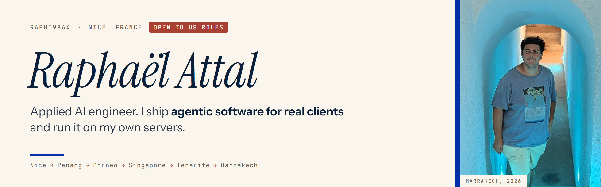
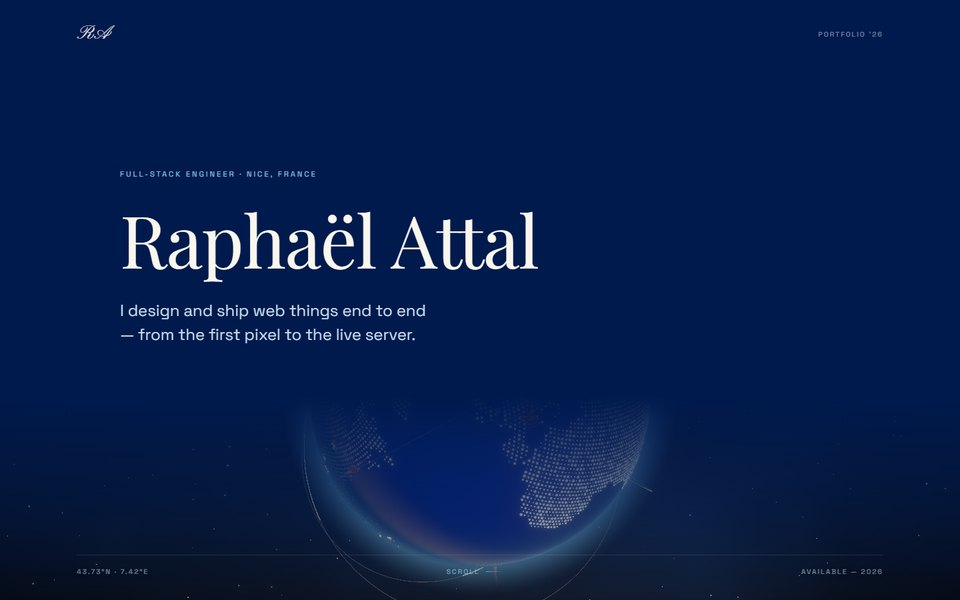
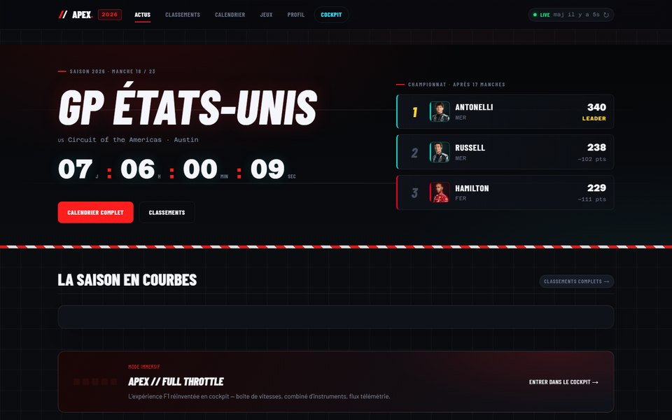
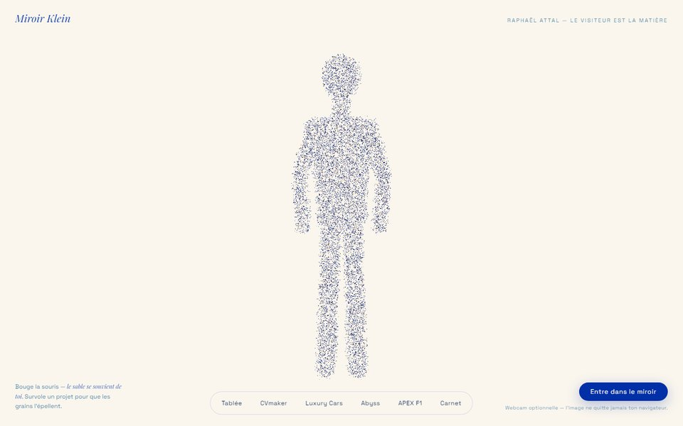
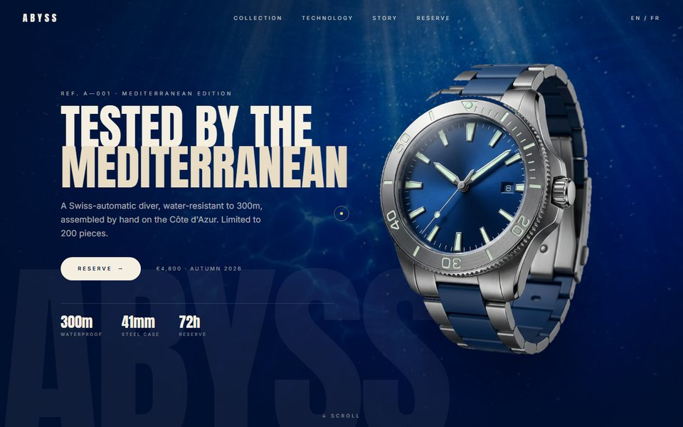

<picture>
  <source media="(prefers-color-scheme: dark)" srcset="assets/banner-dark.png">
  
</picture>

  
  
  
  

I build **agentic websites and AI tools for real clients**, then run them myself in production on a Hetzner VPS with Coolify. Before going freelance in September 2026, I spent three years as a software engineering apprentice at Capgemini (Angular, Spring Boot, React, Flutter) while earning a Master of Engineering in Computer Science at CESI.

**Now:** freelance applied-AI work for small companies · testing whether LLM evals actually catch wrong answers · open to Forward Deployed and Applied AI roles in the US.

## Selected work

<table>
  <tr>
    <td width="50%" valign="top">
      
       <b>raphaelattal.fr</b>: my portfolio on an interactive 3D globe; each marker opens a live project.
       React Three Fiber · Three.js · TopoJSON
    </td>
    <td width="50%" valign="top">
      
       <b>APEX</b>: a Formula 1 companion with live standings and timing from public F1 APIs, plus reaction-time games.
       React · Vite · Jolpica + OpenF1 APIs
    </td>
  </tr>
  <tr>
    <td width="50%" valign="top">
      
       <b>Miroir Klein</b>: 16,000 particles that follow your cursor, or your body through the webcam (opt-in).
       React Three Fiber · GLSL · MediaPipe
    </td>
    <td width="50%" valign="top">
      
       <b>Abyss</b>: a concept launch site for a hand-assembled dive watch.
       SolidStart · GSAP · Lenis · Tailwind
    </td>
  </tr>
</table>

Everything above runs on my own server: Docker containers behind Traefik, deployed with Coolify on a hardened Hetzner VPS.

## Stack

 

 

## Beyond code

I lived four months in Penang, Malaysia, for an internship, with trips to Borneo, Singapore and Thailand. I design and 3D-print my own parts, cut my travel films in code with Remotion, and spend too many evenings in Blender.

Nice, France · open to relocating to the US

